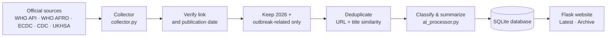

# Outbreak Watch

**Outbreak Watch** is a small, source-first website that automatically collects public outbreak and public-health news from official sources, classifies it, and keeps a searchable archive, always linking back to the original report.

It is built for people who want one place to see what WHO, ECDC and similar bodies have published about outbreaks, without having to check each site separately.

> ⚠️ **This is an MVP / demonstration project**, not a validated public-health surveillance system. Classifications and summaries can be wrong. The original source linked on every item is always the authoritative version.

---

## What it does

- **Collects** reports on a schedule (every 30 minutes by default) from official sources: WHO Disease Outbreak News, WHO AFRO, ECDC (epidemiological updates, weekly threats report, risk assessments), Eurosurveillance, US CDC Travel Health Notices and the UK Health Security Agency.
- **Verifies** every link before saving it: the page must actually load, and its publication date is cross-checked on the article page itself.
- **Filters** to reports published in the current year (2026) and to outbreak-related content.
- **Classifies** each report by category, disease/event, country/region and outbreak status, and writes a short neutral summary when AI is enabled.
- **Removes duplicates** by URL and by near-identical titles.
- **Displays** everything on three pages:
  - **Latest** – the most recent reports, with headline stats
  - **Archive** – everything collected so far
  - **Sources** – every configured source, with report counts and a link to the publisher
- **Search and filters** by keyword, country/region, disease/event, category and source.

Every item shows its original source name and a link to the original report. The site never invents sample news: if nothing has been collected, it says so.

---

## How it works



1. **Collection** – `collector.py` reads each enabled source in `sources.json`. Four source types are supported:

   | Type | How it works |
   |---|---|
   | `who_api` | Reads WHO's Disease Outbreak News JSON API |
   | `rss` | Reads a standard RSS/Atom feed |
   | `web_scrape` | Reads a listing page with Requests + BeautifulSoup, then opens each article |
   | `ai_scrape` | Uses [ScrapeGraphAI](https://github.com/ScrapeGraphAI/Scrapegraph-ai) (an LLM) to read a listing page; every link and date it returns is then checked on the real page |

   Scrapers respect each site's `robots.txt` and only follow links on the source's own domain.

2. **Verification** – Links are opened before saving. Broken pages, including "page not found" pages that still return HTTP 200, are skipped. When the article page shows its own publication date, that date is used instead of the feed's date.

3. **Classification** – `ai_processor.py` sorts each report into one of:
   *Outbreak investigation · Emerging public health threat · Official public health update · Research / surveillance · Not relevant.*
   - **With AI enabled:** an OpenAI model returns structured fields and a summary of up to 55 words. It is instructed to use only facts stated in the source and to write `Unknown` rather than guess.
   - **Without AI:** simple keyword rules decide relevance and pick out the country where possible. No summary is generated, so nothing is invented.

4. **Storage and display** – Results are stored in SQLite (`schema.sql`) and served by a Flask app (`app.py`).

---

## Project structure

```
outbreak-watch/
├── app.py              # Flask website + background collection loop
├── collector.py        # Fetching, scraping, verification, dedup, saving
├── ai_processor.py     # AI classification/summary with keyword fallback
├── sources.json        # List of sources (enable/disable here)
├── schema.sql          # Database table definition
├── templates/          # HTML pages (base, latest, archive, sources)
├── static/style.css    # Styling
├── requirements.txt    # Python dependencies
├── Dockerfile          # Container image (includes Chromium for ScrapeGraphAI)
├── render.yaml         # One-click deployment config for Render
└── Procfile            # Process definition for Procfile-based hosts
```

---

## Run it locally

Requires **Python 3.11+**.

```bash
git clone https://github.com/MOHZOOM/outbreak-watch.git
cd outbreak-watch

python -m venv .venv
source .venv/bin/activate          # Windows: .venv\Scripts\activate
pip install -r requirements.txt
playwright install chromium        # only needed for ai_scrape sources

python app.py
```

Then open <http://127.0.0.1:5000>.

The first collection starts automatically when the app starts. To run one collection by hand without the website:

```bash
python collector.py
```

### Configuration

Settings are read from environment variables, or from a `.env` file in the project folder. Never commit that file.

| Variable | Default | Purpose |
|---|---|---|
| `AI_ENABLED` | `false` | Set to `true` to use OpenAI for classification and summaries |
| `OPENAI_API_KEY` | – | Needed for AI classification and `ai_scrape` sources |
| `OPENAI_MODEL` | `gpt-4o-mini` | Model used for classification and scraping |
| `DATABASE_PATH` | `outbreak_watch.db` | Where the SQLite database is stored |
| `COLLECTION_INTERVAL_SECONDS` | `1800` | Time between collection runs (30 min) |
| `DISABLE_SCHEDULER` | `false` | Set to `true` to stop automatic collection |
| `FLASK_SECRET_KEY` | dev value | Set a random value in production |
| `PORT` | `5000` | Port for the local server |

Example `.env`:

```env
AI_ENABLED=true
OPENAI_API_KEY=sk-...
OPENAI_MODEL=gpt-4o-mini
```

The site works without an API key. It falls back to keyword rules, and any source of type `ai_scrape` will simply fail and be skipped.

### Adding or changing sources

Edit `sources.json`:

```json
{
  "name": "ECDC Epidemiological Updates",
  "url": "https://www.ecdc.europa.eu/en/taxonomy/term/1310/feed",
  "type": "rss",
  "enabled": true
}
```

`homepage`, `region` and `about` are optional and only used on the Sources page. Sources run in file order, so keep fast RSS feeds first and slow scrapers (especially `ai_scrape`) last; the site then fills up within seconds after a restart.

Prefer official sources with an RSS feed or API. Before adding a site, check its terms of use and `robots.txt`, and don't scrape sites that disallow automated access.

---

## Deploy to Render

The repository includes a `render.yaml` blueprint.

1. In [Render](https://render.com), create a **New → Blueprint** and select this repository.
2. Add `OPENAI_API_KEY` as a secret environment variable (AI is enabled in the blueprint).
3. Deploy, then check the logs to confirm reports are being collected.

**Note on the free plan:** free Render services have a temporary filesystem and go to sleep when idle. The archive can be lost on restart or redeploy, and collection pauses while the service sleeps. That's fine for a demo. For a lasting archive, use a paid plan with a persistent disk or a managed database.

---

## Limitations and next steps

- Only reports dated **2026** are kept (`CURRENT_YEAR` in `collector.py`).
- Source metadata varies, so location, disease or status may show as `Unknown`.
- AI classifications and summaries can be wrong; always check the original report.
- Collection runs inside the web process, so only one Gunicorn worker is used.

Before any real public-health use, the plan is to add:

- a human review step before items are published
- a dedicated scheduled worker and a PostgreSQL database
- tests, monitoring, backups and rate limiting
- more official sources, and an accessibility and security review
